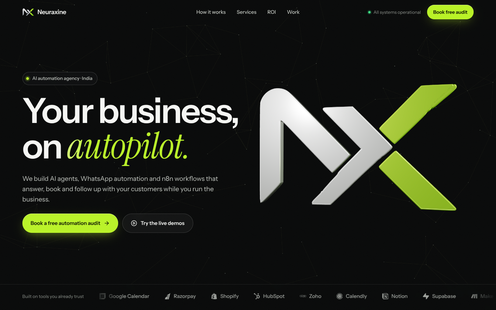
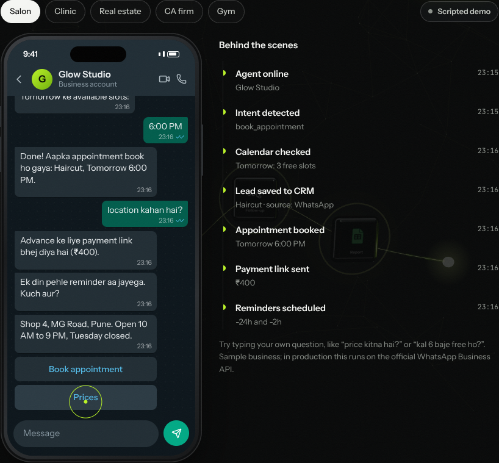
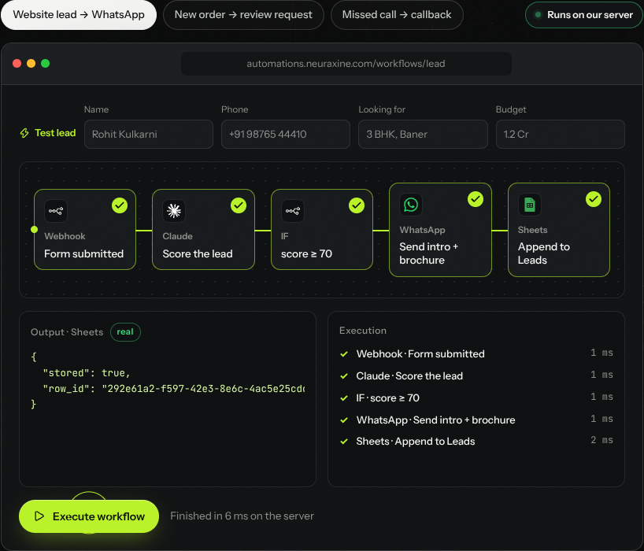
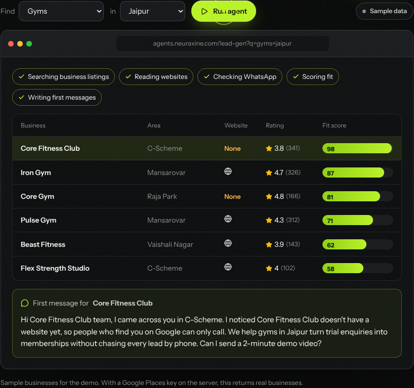

# Neuraxine website

The Neuraxine agency site. The hero shows a 3D version of the Neuraxine logo, traced from the original artwork and extruded in chrome and lime. As you scroll, a workflow network takes over: one customer message travels WhatsApp → AI agent → CRM → calendar → follow-up → report. Each service then has a **live demo connected to a real backend**.



## Page structure

1. **Hero:** 3D logo, headline, a scrolling strip of brand logos
2. **How it works:** scroll-driven journey through the 3D workflow network
3. **Live demos:** WhatsApp agent, n8n workflow, lead-gen agent, custom SaaS (backed by the API)
4. **More services:** a bento grid of six more services, each with a looping micro-demo. The voice agent plays a real spoken sample call using the browser's speech engine; the others show a website chatbot, invoice reading, a content calendar, a CRM pipeline and a website being built.
5. **Industries:** a sideways-scrolling rail with use cases for eight trades
6. **ROI calculator, process, integrations, builds**
7. **FAQ:** accordion, with FAQPage structured data for search engines
8. **Contact:** the free-audit form, a footer, and a floating WhatsApp button (number in `src/site.js`)

## Run it

```bash
npm install
npm run build
npm run server          # site + API on http://localhost:8787
```

For development, run `npm run server` in one terminal and `npm run dev` in another. Vite (http://localhost:5173) proxies `/api` to the server.

```bash
npm test                # 15 API tests (vitest + supertest)
```

## Deploy on Vercel

The repo is set up for Vercel: `vercel.json` builds the Vite site and routes every `/api/*` request to `api/index.js`, which runs the same Express app as a serverless function.

1. Import the repo in Vercel. The settings are picked up from `vercel.json`.
2. In **Project → Settings → Environment Variables**, add the keys from `.env.example` that you want live.
3. **Set `N8N_WEBHOOK_URL` and/or `RESEND_API_KEY` + `LEAD_EMAIL_TO`.** Vercel doesn't keep files between requests, so on Vercel the audit form only reaches you through the webhook or email.
4. Redeploy. Check `https://<your-domain>/api/health`: `services` shows which keys are active.

## Backend (`server/`)

An Express app that serves the built site and the API from one port, so it deploys anywhere Node runs (Render, Railway, a VPS).

| Endpoint | What it does | Real service it uses when configured |
|---|---|---|
| `GET /api/health` | Live status used by the nav's "All systems operational" pill and the demo badges | — |
| `POST /api/contact` | Validates the audit form, rate-limits, saves to `data/contacts.jsonl`, forwards the lead | n8n webhook (`N8N_WEBHOOK_URL`), email via Resend (`RESEND_API_KEY`, `LEAD_EMAIL_TO`) |
| `POST /api/agent/chat` | WhatsApp agent replies, quick replies and the "behind the scenes" events | Claude (`ANTHROPIC_API_KEY`), using structured JSON output |
| `POST /api/leads/search` | Finds and scores businesses, then drafts a first message | Google Places API (New) (`GOOGLE_PLACES_API_KEY`) + Claude for drafts |
| `POST /api/workflow/run` | Executes the workflow server-side with real per-node timings, stores rows, posts steps to n8n | Claude for lead scoring, n8n webhook |

Every key is optional; see `.env.example`. Without a key, that feature falls back to a built-in engine and the UI badge says so ("Scripted demo", "Sample data"). If a Claude request fails or the model declines, the agent falls back to the scripted reply instead of erroring. If the API can't be reached at all (static hosting), the demos run in the browser and show "Offline demo".

## What's real on the page

- **Logo:** `public/brand/logo.svg` is a vector trace of the supplied logo. The 3D version is built from the same paths (`src/three/logoPaths.json`).
- **Icons:** official brand marks from Simple Icons (CC0) and the Lucide icon set. OpenAI and Slack aren't included because Simple Icons removed them at those companies' request.
- **Demos:** real UI in device frames (an iPhone-style phone with WhatsApp's dark theme, browser windows), backed by the API above.
- **Photos:** none yet. Add your own team or client photos to `public/images/`; real photos of your work will beat stock.

## Edit content

- Copy, services (`services`, `moreServices`), industries, FAQ, process, builds and integrations: `src/site.js`
- Demo businesses, workflows and lead categories: `src/demos/data.js`
- Scripted agent and lead drafts: `src/demos/engine.js` (shared by browser and server)

| WhatsApp agent | n8n workflow | Lead-gen agent |
|---|---|---|
|  |  |  |
