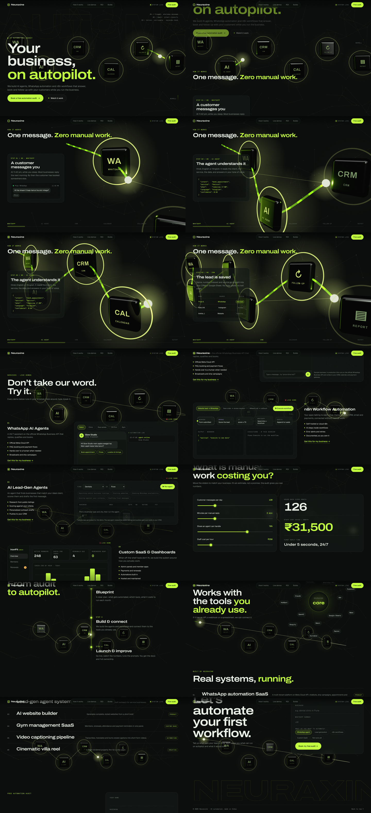

# Neuraxine: "The Living Workflow" site

The agency site for Neuraxine. A 3D workflow network sits behind the page. As you scroll, one customer message travels through it: WhatsApp → AI agent → CRM → calendar → follow-up → report. Each service then has a **live demo** that runs entirely in the browser.


## Run

```bash
npm install
npm run dev      # http://localhost:5173
npm run build    # static output in dist/
```

## Sections

| Section | What it does |
|---|---|
| Hero | Boot-sequence loader, then the network floats in. Big headline and a magnetic CTA |
| How it works | Sticky, 600vh. The camera follows a glowing packet node by node; a card shows what happens at each step (chat, intent JSON, CRM row, booked slot, reminder, daily summary) |
| Live demos | **WhatsApp AI agent:** pick a business type and chat (buttons or free text); an automation log shows CRM, calendar, payment and reminder events. **n8n workflow:** run three templates node by node and inspect each node's output. **Lead-gen agent:** choose a niche and city; the agent streams scored leads and drafts a first message. **Custom SaaS:** a gym admin with KPIs, a check-ins chart, member search and one-click WhatsApp renewal reminders |
| ROI calculator | Sliders produce an estimate of hours and staff cost saved per month |
| Process | Audit → Blueprint → Build → Launch, with a line that draws as you scroll |
| Integrations | Two counter-rotating orbits of tools around a core |
| Builds | Things Neuraxine has actually built (no invented metrics) |
| Contact | Free-audit form and footer |

## Before going live

- **Copy and services:** edit `src/site.js`. The current copy was written without access to neuraxine.com, so replace anything that doesn't match how you describe your work.
- **Contact form:** set `formEndpoint` in `src/site.js` to an n8n webhook, Formspree or similar URL. Until then the form tells visitors it isn't connected, instead of pretending the request was sent.
- **Demo data:** businesses, prices and numbers in `src/demos/data.js` are fictional and labelled "sample" on screen. Change the industries, flows and workflow templates there.

## Stack

React 19 · React Three Fiber · GSAP ScrollTrigger · Lenis · Framer Motion · Vite. The scroll engine (section coordinate, smooth scroll, reveals, magnetic buttons, cursor) is shared with `../brand-site`. The 3D scene lives in `src/three/Network.jsx`: path, nodes, the flowing-dash shader, packet and trail, and the camera rig that moves through hero, journey and backdrop modes. Each demo is lazy-loaded.


